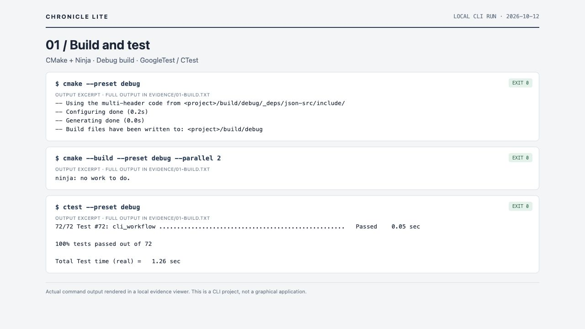
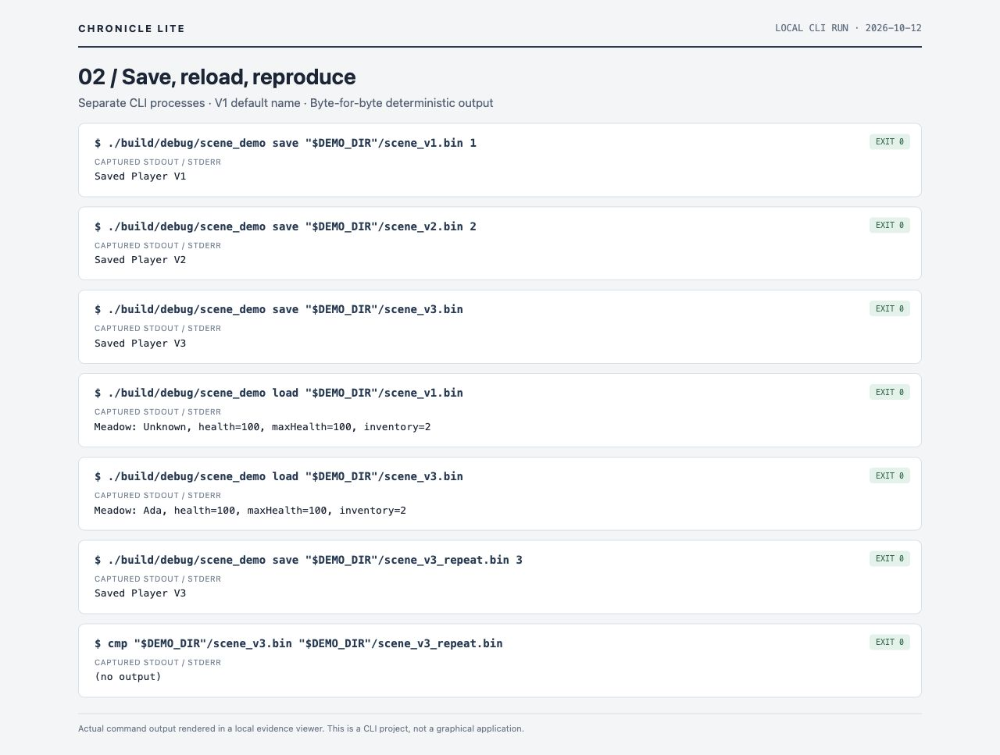
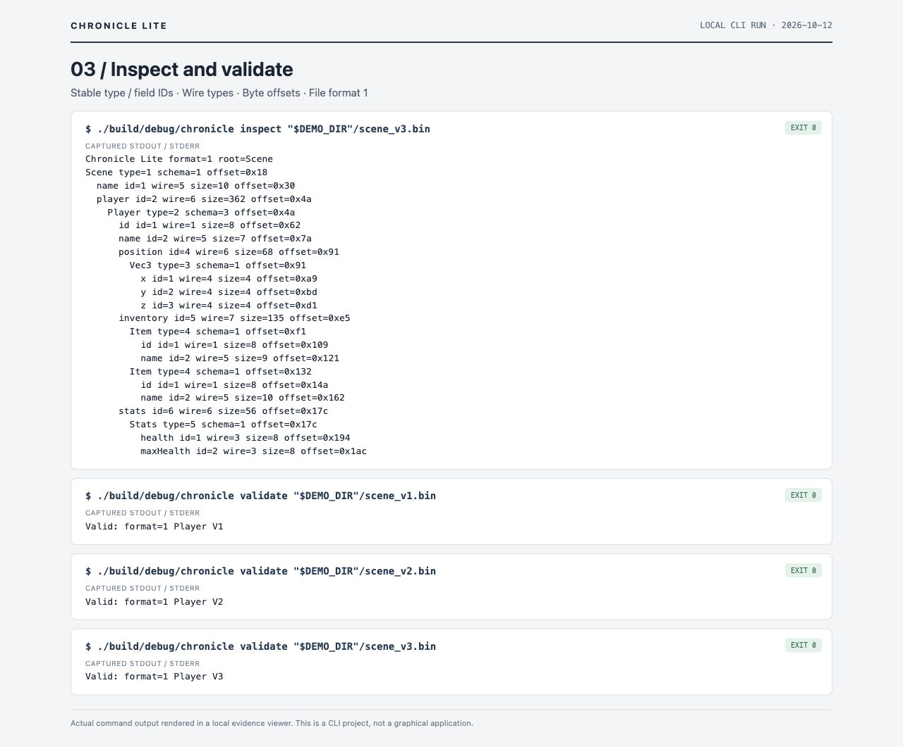
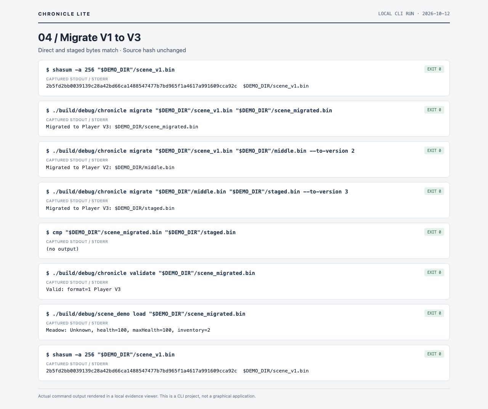
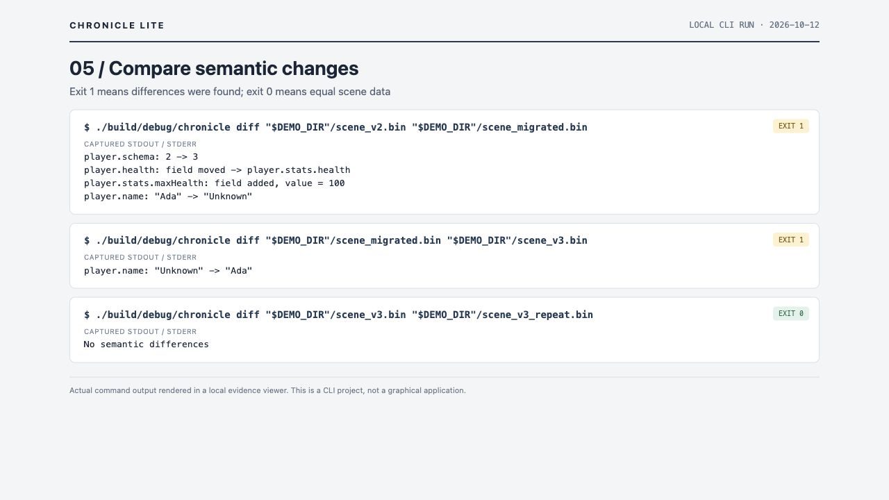
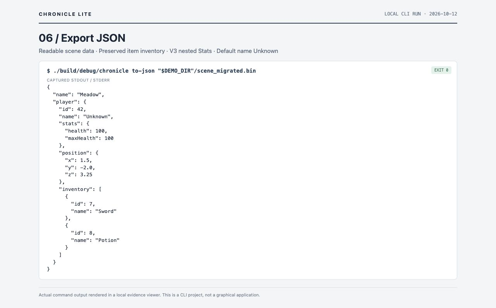
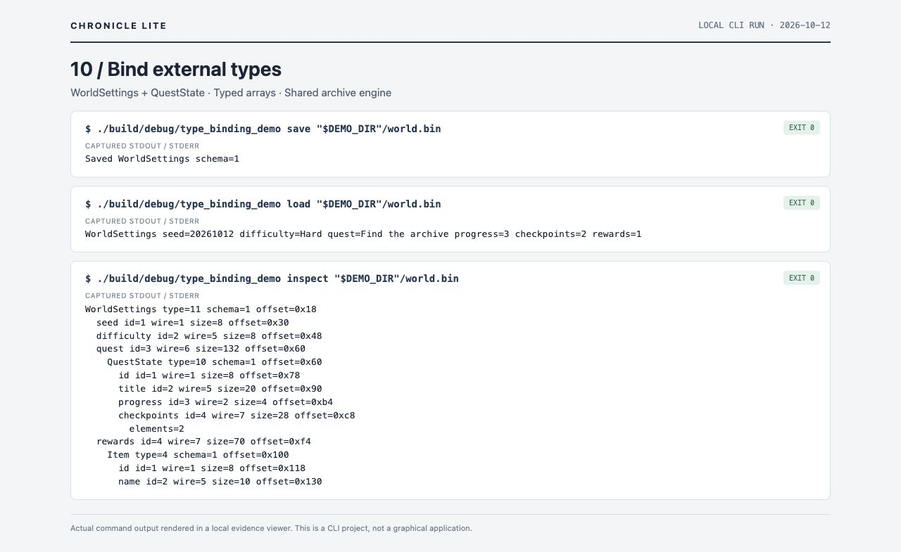
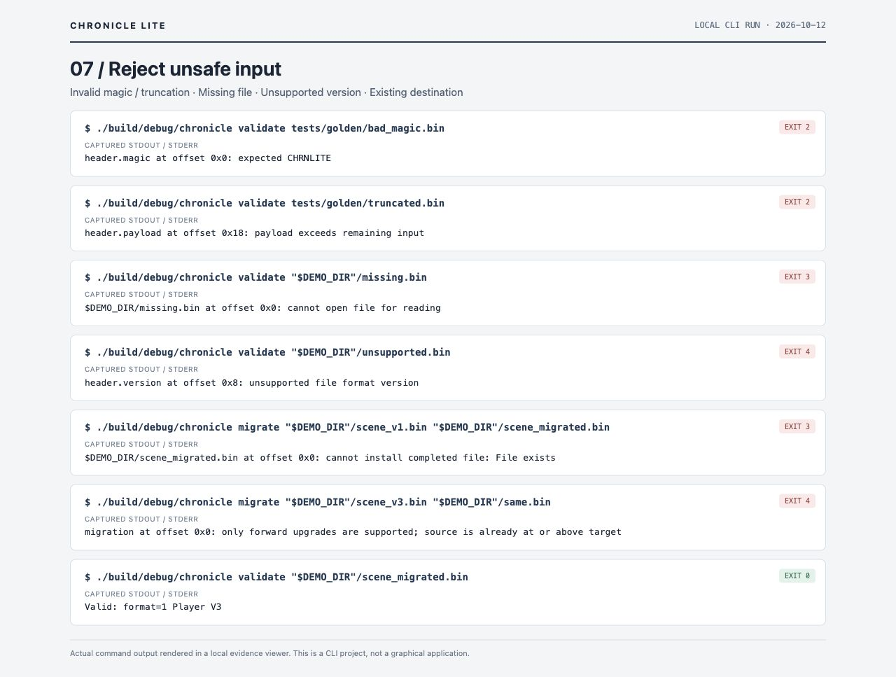
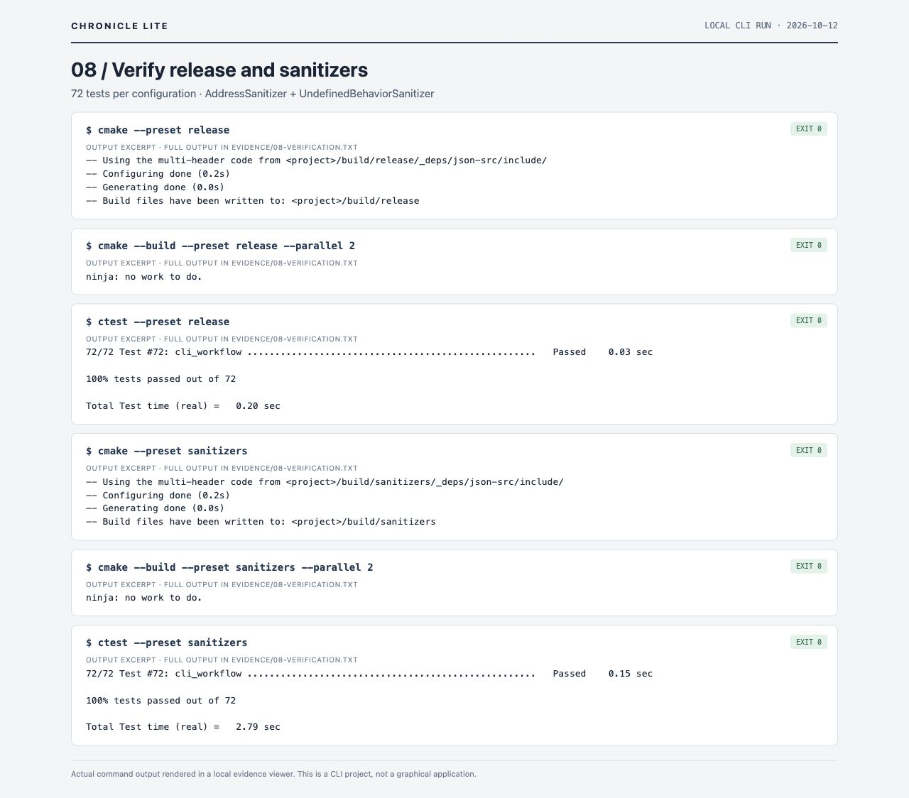
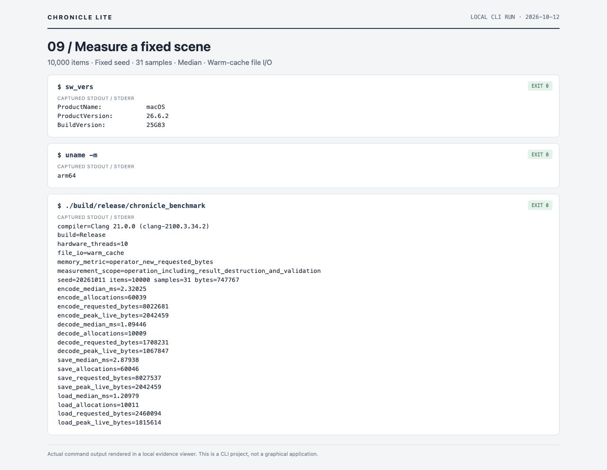

# Chronicle Lite: Workflow Demo

## 1. Build and Test

Requires CMake 3.28+, Ninja, and a C++20 compiler.

```sh
cmake --preset debug
cmake --build --preset debug --parallel 2
ctest --preset debug
```



## 2. Save, Reload, and Reproduce

The sample is Meadow with player ID 42, Ada, health 100/100, position (1.5, -2, 3.25), and Sword/Potion items. Save V1/V2/V3; omitting the version selects V3. V1 has no name and loads as Unknown. Another process restores the current Stats model. Repeated V3 saving produces identical bytes, verified with cmp.

```sh
mkdir -p build/demo
export DEMO_DIR="$(mktemp -d build/demo/current-v3.XXXXXX)"
./build/debug/scene_demo save "$DEMO_DIR"/scene_v1.bin 1
./build/debug/scene_demo save "$DEMO_DIR"/scene_v2.bin 2
./build/debug/scene_demo save "$DEMO_DIR"/scene_v3.bin
./build/debug/scene_demo load "$DEMO_DIR"/scene_v1.bin
./build/debug/scene_demo load "$DEMO_DIR"/scene_v3.bin
./build/debug/scene_demo save "$DEMO_DIR"/scene_v3_repeat.bin 3
cmp "$DEMO_DIR"/scene_v3.bin "$DEMO_DIR"/scene_v3_repeat.bin
```



## 3. Inspect and Validate

Inspect shows file format 1, Player schema 3, and Stats under Player field ID 6 (type ID 5, schema 1), with int64 health/maxHealth. Sizes and offsets come from actual records. Validate identifies the source version of each archive.

```sh
./build/debug/chronicle inspect "$DEMO_DIR"/scene_v3.bin
./build/debug/chronicle validate "$DEMO_DIR"/scene_v1.bin
./build/debug/chronicle validate "$DEMO_DIR"/scene_v2.bin
./build/debug/chronicle validate "$DEMO_DIR"/scene_v3.bin
```




## 4. Migrate V1 to V3

The default target is V3; explicit --to-version 2 retains V1→V2. V1→V2 widens signed health and supplies Unknown; V2→V3 moves it into Stats and infers maxHealth=max(100, health). The direct route validates an intermediate V2 and installs only the final archive. cmp confirms direct/staged byte equality; source SHA-256 is unchanged.

```sh
shasum -a 256 "$DEMO_DIR"/scene_v1.bin
./build/debug/chronicle migrate "$DEMO_DIR"/scene_v1.bin "$DEMO_DIR"/scene_migrated.bin
./build/debug/chronicle migrate "$DEMO_DIR"/scene_v1.bin "$DEMO_DIR"/middle.bin --to-version 2
./build/debug/chronicle migrate "$DEMO_DIR"/middle.bin "$DEMO_DIR"/staged.bin --to-version 3
cmp "$DEMO_DIR"/scene_migrated.bin "$DEMO_DIR"/staged.bin
./build/debug/chronicle validate "$DEMO_DIR"/scene_migrated.bin
./build/debug/scene_demo load "$DEMO_DIR"/scene_migrated.bin
shasum -a 256 "$DEMO_DIR"/scene_v1.bin
```




## 5. Compare Structure and Values

The first comparison reports schema 2→3, health moving into Stats, added maxHealth, and Ada→Unknown. The name change comes from the V1 source lacking a name. Migrated and native V3 differ only in name; repeated V3 has no semantic differences. Diff exit 1 normally means differences; exit 0 means equality.

```sh
./build/debug/chronicle diff "$DEMO_DIR"/scene_v2.bin "$DEMO_DIR"/scene_migrated.bin
echo $?
./build/debug/chronicle diff "$DEMO_DIR"/scene_migrated.bin "$DEMO_DIR"/scene_v3.bin
echo $?
./build/debug/chronicle diff "$DEMO_DIR"/scene_v3.bin "$DEMO_DIR"/scene_v3_repeat.bin
```




## 6. Export Current-model JSON

JSON always exposes the current model. Even for V1/V2 input, health is player.stats.health and maximum health is player.stats.maxHealth. This migrated scene has the name Unknown. The redirect below saves JSON; the screenshot shows the same command without redirection.

```sh
./build/debug/chronicle to-json "$DEMO_DIR"/scene_migrated.bin > "$DEMO_DIR/scene_migrated.json"
```

```json
{
  "name": "Meadow",
  "player": {
    "id": 42,
    "name": "Unknown",
    "stats": {
      "health": 100,
      "maxHealth": 100
    },
    "position": {
      "x": 1.5,
      "y": -2.0,
      "z": 3.25
    },
    "inventory": [
      {
        "id": 7,
        "name": "Sword"
      },
      {
        "id": 8,
        "name": "Potion"
      }
    ]
  }
}
```




## 7. Extend the Model with Bindings

The example declares WorldSettings (type ID 11) and QuestState (type ID 10) outside the runtime and uses the shared binding engine to save, load, and inspect them. Output includes seed 20261012, Hard difficulty, Find the archive, progress 3, two float checkpoints, and one Potion reward. Object arrays expand; scalar arrays currently display counts.

```sh
./build/debug/type_binding_demo save "$DEMO_DIR"/world.bin
./build/debug/type_binding_demo load "$DEMO_DIR"/world.bin
./build/debug/type_binding_demo inspect "$DEMO_DIR"/world.bin
```




## 8. Reject Invalid Input and Protect Files

These commands intentionally fail; each following echo prints the expected exit code. Python only prepares a negative fixture with file format version 9; it does not edit project source. An existing migration target is protected and same-version migration fails. The original migrated result still validates afterward. Python 3 is needed only for this demo fixture preparation.

```sh
python3 - <<'PYCODE'
import os
from pathlib import Path
folder = Path(os.environ["DEMO_DIR"])
data = bytearray((folder / "scene_v2.bin").read_bytes())
data[8:10] = (9).to_bytes(2, "little")
(folder / "unsupported.bin").write_bytes(data)
PYCODE
./build/debug/chronicle validate tests/golden/bad_magic.bin
echo $?
./build/debug/chronicle validate tests/golden/truncated.bin
echo $?
./build/debug/chronicle validate "$DEMO_DIR"/missing.bin
echo $?
./build/debug/chronicle validate "$DEMO_DIR"/unsupported.bin
echo $?
./build/debug/chronicle migrate "$DEMO_DIR"/scene_v1.bin "$DEMO_DIR"/scene_migrated.bin
echo $?
./build/debug/chronicle migrate "$DEMO_DIR"/scene_v3.bin "$DEMO_DIR"/same.bin
echo $?
./build/debug/chronicle validate "$DEMO_DIR"/scene_migrated.bin
```




## 9. Verify Release and Sanitizers

All 72 tests pass in each of Release and ASan/UBSan. Coverage includes binary boundaries, golden bytes, bindings, migrations, malformed data, file protection, and real CLI workflows. Screenshots show test summaries; evidence links contain full output. Remote CI execution is outside this verification.

```sh
cmake --preset release
cmake --build --preset release --parallel 2
ctest --preset release
cmake --preset sanitizers
cmake --build --preset sanitizers --parallel 2
ctest --preset sanitizers
```




## 10. Measure Performance and Memory

Current V3 Release run: macOS 26.6.2 / arm64, Clang 21.0.0, 10 hardware threads. Seed 20261011, 10,000 items, 31 timed samples, archive size 747,767 bytes. The table records this run’s medians; timings depend on the environment.

```sh
sw_vers
uname -m
./build/release/chronicle_benchmark
```

| Operation | Median (ms) | Allocations | Total requested bytes | Peak live requested bytes |
| --------- | ----------- | ----------- | --------------------- | ------------------------- |
| encode    | 2.32025     | 60,039      | 8,022,681             | 2,042,459                 |
| decode    | 1.09446     | 10,009      | 1,708,231             | 1,067,847                 |
| save      | 2.87938     | 60,046      | 8,027,537             | 2,042,459                 |
| load      | 1.20979     | 10,011      | 2,460,094             | 1,815,614                 |

Timing includes validation and result destruction. Allocation metrics use a separate operator new sample; counting is disabled during timed samples, although the wrapper remains linked. Peak is not RSS and excludes existing inputs, stack, allocator overhead, and direct malloc. File I/O uses warm caches without fsync durability. Historical E001/E002 V2 data is not a like-for-like performance comparison with V3.




## Exit Codes and Scope

| Exit code | Meaning                                                  |
| --------- | -------------------------------------------------------- |
| 0         | Success or equal diff                                    |
| 1         | Diff found changes                                       |
| 2         | Invalid archive format/data                              |
| 3         | File I/O error, including existing migration destination |
| 4         | Unsupported version or migration route                   |
| 64        | Usage error                                              |
